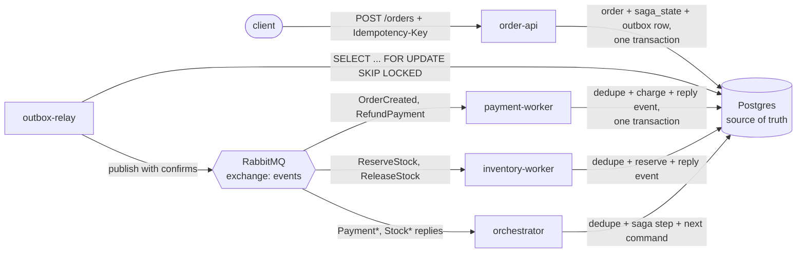

# edops

Event-driven order processing whose failure behavior is understood and provable: a
transactional outbox, idempotent consumers, and an orchestrated saga with compensation.

The question it answers: *if the broker redelivers a message after a consumer crashed
mid-transaction, how do you know no card was charged twice?* `tests/test_chaos.py` kills the
payment worker between its commit and its ack, starts a new one, and checks for one charge.

## Architecture



Only the relay publishes. Every other process writes its outgoing events to the outbox in the
same transaction as the state change that caused them. Delivery is at-least-once; each consumer
records `(consumer, message_id)` in `processed_messages` in that same transaction and acks after
commit. Details, the state machine and the failure catalog: [docs/design.md](docs/design.md).

## Run locally
Requires Python 3.12 and Docker Desktop. If PowerShell refuses to run the activate script, run
`Set-ExecutionPolicy -Scope CurrentUser RemoteSigned` once.
```
copy .env.example .env
py -3.12 -m venv C:\webdev\venvs\edops
C:\webdev\venvs\edops\Scripts\Activate.ps1
pip install -r requirements-dev.txt
docker compose up -d --build --wait
docker compose ps
pytest
python scripts/smoke.py http://localhost:8000
```
Compose runs postgres, rabbitmq, order-api, outbox-relay, payment-worker, inventory-worker and
orchestrator. The API is at http://localhost:8000 and RabbitMQ's UI at http://localhost:15672.

Tests use their own database (`edops_test`, rebuilt from `db/init.sql` on every run) and a
unique broker prefix per test, so they can run while the stack is up. A full run takes about a
minute because the process tests start real workers.

Trace one order through every process:
```
docker compose logs --no-log-prefix | findstr <order_id>
```

Try the failure paths with these customer ids: `fault-payment-declined`,
`fault-stock-rejected`, `fault-after-reserve` (see docs/design.md, failure injection).

For hot reload outside Docker, use another port: `uvicorn app.main:app --reload --port 8001`.

### Schema changes
`db/init.sql` only runs when the Postgres volume is first created. After any change to it,
recreate the volume (this deletes all local data):
```
docker compose down -v
docker compose up -d
```
The test database does not need this; conftest rebuilds it every run.

## Built vs deferred
| Built | Deferred (docs/design.md section 5) |
|---|---|
| Outbox + relay with SKIP LOCKED and publisher confirms | Retries with backoff and jitter |
| Idempotency at the API (per-customer key, request hash, 409) | DLQ and replay CLI |
| Idempotent consumers (processed_messages in the business transaction) | Reconciliation job for stuck sagas |
| Orchestrated saga, refund and release compensation, idempotent by state | Load test |
| DB-level guards: one charge, one refund, refund needs a charge | Chaos tests beyond the one worker kill |
| Deterministic failure injection | Saga timeouts, migrations, connection pool |
| JSON logs with order_id and correlation_id across every hop | Metrics and tracing (cut from scope) |
| CI (ruff, pytest with real Postgres and RabbitMQ, image build) | |
| Railway deploy config and smoke script | |

## Invariants and the tests that prove them
| Invariant | Key tests |
|---|---|
| INV-1 No lost order | `test_outbox_atomicity.py`, `test_relay.py` (re-publish after crash), `test_saga.py::test_orchestrator_restart_mid_saga_resumes`, `test_db_outage.py`, `test_chaos.py` |
| INV-2 No double charge | `test_idempotency.py` (redelivery, crash after commit), `test_idempotency_race.py`, `test_payment_rules.py`, `test_saga.py` (one refund), `test_chaos.py` |
| INV-3 No orphaned reservation | `test_saga.py::test_failure_after_reservation_releases_and_refunds_exactly_once`, `test_idempotency.py` (release twice, all-or-nothing) |

The full map is in docs/design.md section 7. Every invariant has a passing test. Not proven:
an order whose message can never succeed stays PENDING forever (failure catalog F7).

## Cost (honest)
On Railway's Hobby plan, about **$10-15/month** for all seven services: $5 plan fee that covers
the first $5 of usage, with RAM about $10/GB-month and CPU about $20/vCPU-month after that.
Five idle Python processes (about 100 MB each) plus Postgres and RabbitMQ come to roughly 1 GB.
That is an estimate from published rates, not a bill; check the dashboard after a week. The same
setup on Render is about $40-45/month because each background worker needs a paid instance.

## What changes at 100x
- **Relay throughput** becomes the first wall: it waits for one broker confirm per message.
  Switch to batched or async confirms, and run several relays (already safe with SKIP LOCKED).
- **Workers** move from prefetch 1 and one replica to many replicas with higher prefetch. The
  dedupe and row locks already make competing consumers safe.
- **The orchestrator** runs as several replicas too; the per-order `FOR UPDATE` serializes
  events for one order, so replicas can share a queue.
- **Unbounded tables**: `outbox` and `processed_messages` grow forever today. They need
  pruning or time partitioning (keep dedupe rows only as long as redelivery is possible).
- **Connections**: one Postgres connection per request and per process stops scaling; add a
  pool (PgBouncer).
- **F7 becomes an outage**: a poison message spinning at 100x traffic floods logs and starves a
  worker. Bounded retries and a DLQ stop being optional, and so do metrics and alerting on queue
  depth, outbox lag and stuck sagas.
- **RabbitMQ**: quorum queues on a cluster instead of one node's classic queues.
- **Cost** moves from about $15 to a few hundred dollars a month, mostly for Postgres and
  more replicas.
